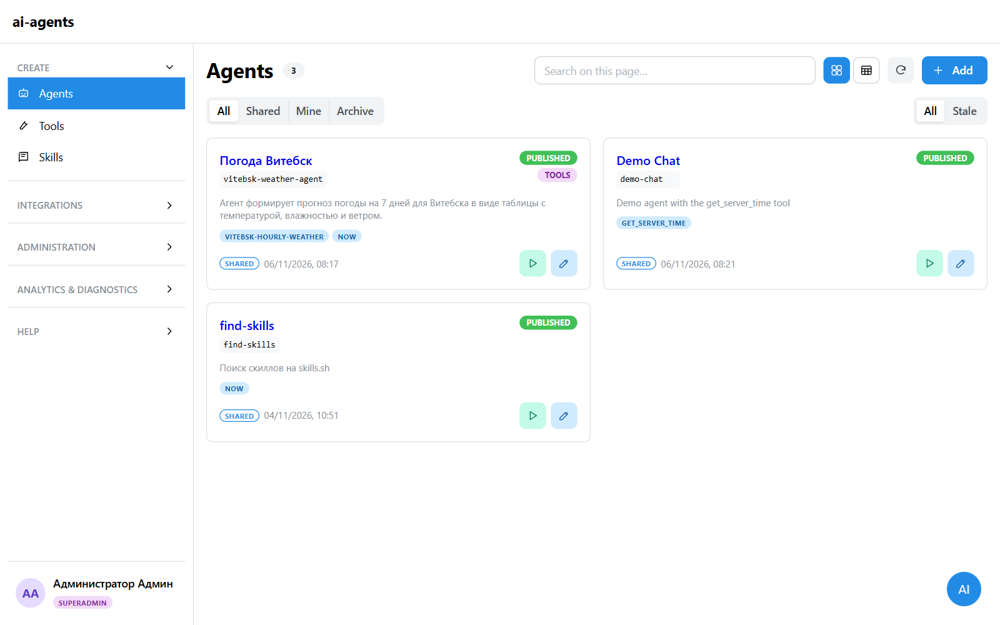
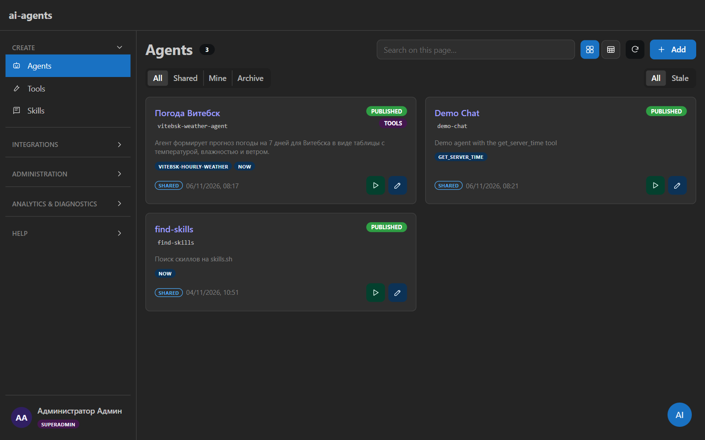
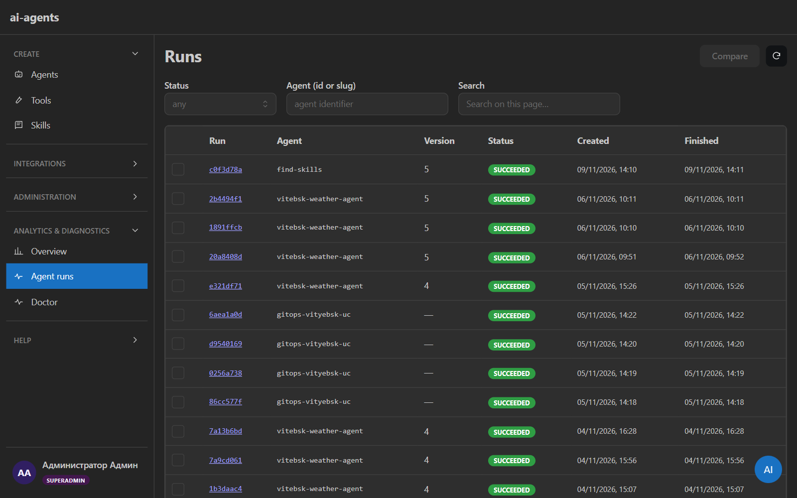
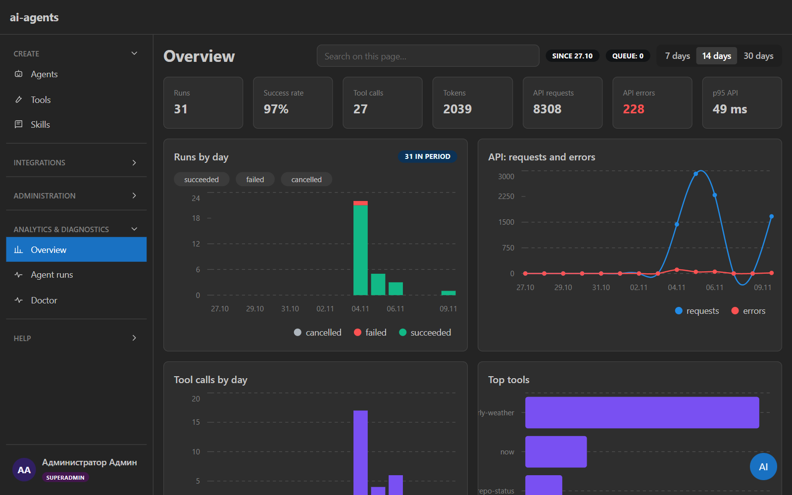
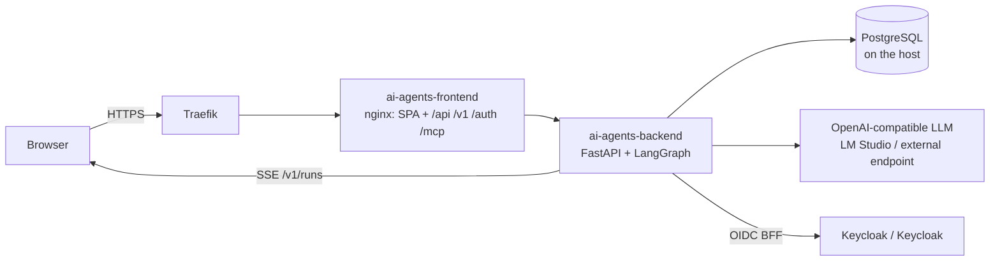

<div align="center">


<h1>ai-agents</h1>

ai-agents agent control plane: build, publish and run LLM agents.<br>
LangGraph ReAct agents with tools, skills and MCP, `POST /v1/runs` + SSE,
a React/Mantine admin UI, roles and limits, usage accounting.


<sub>English · <a href="../README.md">Русская версия</a> · <a href="../docs/API.md">API</a> · <a href="../docs/NUANCES.md">Deployment notes</a></sub>

</div>

---

| Light | Dark |
|---|---|
|  |  |
|  |  |

> Screenshots are taken from the work stand (`ai-agents-dev.example.com`) as
> a superadmin: agents, runs and analytics. Theme and language switches live in the
> header and settings.

## Contents

- [Highlights](#highlights)
- [How it works](#how-it-works)
- [Quick start](#quick-start)
- [API](#api)
- [Access and roles](#access-and-roles)
- [Configuration](#configuration)
- [Deployment](#deployment)
- [Development and tests](#development-and-tests)
- [Project layout](#project-layout)
- [Documentation](#documentation)
- [Limitations](#limitations)
- [Contributing](#contributing)

## Highlights

| | |
|---|---|
| **Agents as data** | CRUD, versions, publish, clone and rollback to any version (publishes a new one). System prompt, LLM profile, step/time limits. |
| **Tools** | Built-ins (`calculator`, `now`, `get_server_time`) plus a no-code HTTP builder with testing; tool edits apply to new runs immediately. |
| **Skills** | `SKILL.md`: import from skills.sh, create from a template, generate with the assistant from a short prompt, edit in the UI. |
| **MCP both ways** | Outbound MCP servers (agents as tools for external clients) and inbound MCP connections (tools of external servers). |
| **Runs and SSE** | `POST /v1/runs` plus `GET /v1/runs/{id}/events`, cancel, preflight, approvals for mutating tools, digest/harness/transcript and run comparison. |
| **Sub-agents, memory, schedules** | Nested runs, agent memory, cron schedules, notification channels and a delivery outbox. |
| **LLM providers** | Named OpenAI-compatible providers (base_url/key/model), active provider switch, model listing. |
| **Access** | People — Keycloak OIDC (BFF cookie); machines — `SERVICE_API_KEYS` and DB keys with scopes. Roles `superadmin` / `admin` / `user`, daily run limits. |
| **Catalog and invoke** | `/v1/catalog` + `/v1/tools/{ref}/invoke` for orchestrators, with allowlists for service keys. |
| **Analytics** | Runs, tool calls and API requests stored in Postgres (`usage_events`); usage charts and top agents/tools/endpoints. Optional Langfuse. |
| **Assist** | Service-wide chat and AI form autofill (sees only the registered form, never the DOM). |
| **UI** | Stock Mantine, Light / Dark / Portracker themes, shared page scaffolds, i18n EN/RU (RU by default). |
| **Operations** | Structured loguru logs with rotation, `/health`, `/v1/doctor`, Compose + Traefik, offline builds, k8s GitOps + SOPS. |

## How it works



Traefik routes to the frontend (nginx), which serves the SPA and reverse-proxies
`/api`, `/v1`, `/auth`, `/health`, `/mcp` to the backend. Runs and events are
persisted in PostgreSQL on the host, while live SSE and cancellation happen
in-process (`RunManager` / `LiveHub`) — hence a single replica. LLM inference is
an external OpenAI-compatible endpoint; app pods never request a GPU.

Production deploys are GitOps: `git tag` → CI `decide` → BuildKit/retag →
`bump newTag` → Argo CD → k8s namespace `ai-agents` with an init-container migration.

## Quick start

### Docker Compose (work profile)

```bash
cp docker/.env.example docker/.env
cp docker/.env.secrets.example docker/.env.secrets
# docker/.env — FQDN, ports, auth-test OIDC; docker/.env.secrets — DATABASE_URL,
# KEYCLOAK_CLIENT_SECRET, SESSION_SECRET_KEY, SERVICE_API_KEYS
docker compose --env-file docker/.env --env-file docker/.env.secrets up -d --build
```

- `ai-agents-migrate` (`restart: "no"`) is the only DDL path: it creates the database
  and applies migrations; the backend waits for it.
- Host ports: `${BACKEND_PUBLISH_PORT:-8096}` → backend:8080,
  `${FRONTEND_PUBLISH_PORT:-4196}` → frontend:80.
- Traefik: external `traefik_proxy` network; hosts entry
  `127.0.0.1 ai-agents-dev.example.com`.

Lab/home (local `keycloak-dev`, LM Studio on the host):

```bash
cp docker/.env.lab.example docker/.env
docker compose -f docker-compose.yml -f docker-compose.lab.yml \
  --env-file docker/.env --env-file docker/.env.secrets up -d --build
```

Offline build from the local cache (Windows helper):

```powershell
.\scripts\docker\up-offline.ps1              # lab: build + up --lab
.\scripts\docker\up-offline.ps1 -NoBuild     # up only
.\scripts\docker\up-offline.ps1 -Work        # work profile without the lab overlay
```

### Local, without Docker

```bash
# backend
cd backend
uv sync --extra dev
cp ../docker/.env.example .env
cp ../docker/.env.secrets.example .env.secrets
SERVICE_API_KEYS=dev-key uv run alembic upgrade head
SERVICE_API_KEYS=dev-key uv run uvicorn app.main:app --reload --port 8096

# frontend (second terminal): http://localhost:5173, /api proxied to :8096
cd frontend
npm ci
npm run dev
```

Smoke:

```bash
curl http://localhost:8096/health
curl http://localhost:8096/v1/agents -H "Authorization: Bearer dev-key"
```

Full smoke (`POST /v1/runs` → SSE) — [`docs/API.md` § Smoke](../docs/API.md#smoke-curl).

## API

The contract lives in [`docs/API.md`](../docs/API.md). Key groups:

| Method | Path | Access |
|---|---|---|
| GET/POST | `/v1/agents`, `/v1/agents/{ref}` | `agents:read` / `agents:write` |
| POST | `/v1/agents/{ref}/publish` · `/rollback` · `/clone` | owner/superadmin |
| GET/POST | `/v1/tools`, `/v1/tools/custom` | `tools:*` or `agents:*` |
| POST | `/v1/tools/{ref}/test` · `/invoke` | `tools:write` / `tools:execute` |
| GET/POST | `/v1/skills`, `/v1/skills/import` | `skills:*` or `agents:*` |
| GET/POST | `/v1/mcp-connections` | `agents:read` / `agents:write` |
| POST | `/mcp` (Streamable HTTP) | Bearer `mcp-ag-…` |
| GET | `/v1/catalog`, `/v1/runs/{id}/harness`, `/digest`, `/transcript` | `runs:read` |
| POST | `/v1/runs`, `/v1/runs/preflight`, `/v1/runs/{id}/cancel` | `runs:execute` |
| GET | `/v1/runs/{id}/events?after=<seq>` | `runs:read` (SSE) |
| GET/POST | `/v1/schedules` | `runs:execute` |
| GET | `/v1/stats/overview?days=14` | `runs:read` |
| GET | `/v1/doctor` | `admin` |
| GET/PUT | `/v1/settings/llm` | `agents:read` / `admin` |
| GET/POST | `/api/admin/users`, `/api/admin/service-keys` | cookie superadmin |

`ref` is an `id` (UUID) or a `slug`. Full access rules and error codes are in
[`docs/API.md`](../docs/API.md).

## Access and roles

| Role | Permissions |
|---|---|
| `superadmin` | Everything: users/roles/limits, service and MCP keys, LLM providers; bootstrap via `SUPERADMIN_EMAILS` |
| `admin` | CRUD and publish own agents/skills/tools, read analytics; no access management |
| `user` | Published shared agents: view and test-run; daily limit (`USER_DAILY_RUN_LIMIT`) |

People sign in through Keycloak (cookie session); machines use a Bearer key
(`SERVICE_API_KEYS` or a UI-issued key with scopes and allowlists).

## Configuration

The full list and the Secret/ConfigMap layers are in
[`infra/k8s/ENV_LAYERS.md`](../infra/k8s/ENV_LAYERS.md).

| Variable | Purpose |
|---|---|
| `DATABASE_URL` | PostgreSQL on the host (`postgresql+asyncpg://…@host.docker.internal:5432/ai_agents`) |
| `SERVICE_API_KEYS` | Bootstrap `/v1/*` keys (full access) |
| `KEYCLOAK_ISSUER/CLIENT_ID/CLIENT_SECRET/REDIRECT_URI` | OIDC BFF |
| `DIRECTORY_ADMIN_CLIENT_ID/SECRET` | Optional client with `view-users` for the user directory |
| `SUPERADMIN_EMAILS` | Accounts always granted `superadmin` |
| `DEFAULT_LLM_BASE_URL/MODEL/API_KEY` | Fallback LLM when no provider is active |
| `MAX_STEPS`, `RUN_TIMEOUT_SECONDS` | Agent defaults; `*_CAP` — upper bounds |
| `USER_DAILY_RUN_LIMIT`, `USER_DAILY_TOKEN_LIMIT` | `user` role limits (0 = unlimited) |
| `MCP_ALLOWED_HOSTS`, `MCP_EGRESS_ALLOWED_HOSTS` | DNS-rebinding allowlist and permitted private MCP targets |
| `GITHUB_TOKEN`, `SKILLS_SH_TOKEN` | Skill import/search |
| `LANGFUSE_HOST/PUBLIC_KEY/SECRET_KEY` | Tracing (optional) |
| `STORAGE_PATH`, `LOG_DIR` | Data and logs (`/data`, `/data/logs`) |

Secrets (`DATABASE_URL`, `KEYCLOAK_CLIENT_SECRET`, `SESSION_SECRET_KEY`,
`SERVICE_API_KEYS`, LLM/integration keys) belong to `docker/.env.secrets` and the
SOPS secret only — never in a ConfigMap or `.env.example`.

Logs: `app_YYYY-MM-DD.log`, rotated at 00:00, kept for 30 days, older files zipped.
The file gets `DEBUG`, the console gets `INFO`.

## Deployment

### Contours and FQDN

| Contour | FQDN | Stack |
|---|---|---|
| Lab/work | `ai-agents-dev.example.com` | Compose + Traefik, IdP `keycloak.example.com` |
| Prod k8s (prod) | `ai-agents.example.com` | Kustomize + Argo CD + SOPS, IdP `keycloak.example.com` |

### Production (k8s + GitOps)

- Namespace: `ai-agents`; images: `registry.example.com/ai-agents/backend`, `…/frontend`.
- Manifests: [`infra/k8s`](../infra/k8s) (ConfigMap, Deployments, Services, HTTPRoute, PVC).
- Migrations: `initContainer migrate-db` (`alembic upgrade head`).
- Secrets: `infra/k8s/ai-agents-secret.enc.yaml` (SOPS/KSOPS; created by ops, the age key is not in CI).
- Data: PVC `ai-agents-data` (RWO, `Recreate`, one replica) → `/data`.
- CI: `.gitlab-ci.yml`; **any git tag** → `decide-images` → build/retag → `bump newTag` → Argo Sync.

```bash
git tag v0.1.0
git push origin v0.1.0
```

Image selection is automatic (diff against the previous tag); override with
`BUILD_IMAGES=all|backend,frontend`. Offline jobs live in `gitlab-ci/offline/*`
and are **not** included in the root CI.

Deployment notes:
[`docs/NUANCES.md`](../docs/NUANCES.md).

## Development and tests

Dependencies use [uv](https://docs.astral.sh/uv/) and are pinned in `backend/uv.lock`:

```bash
cd backend
uv sync --extra dev
uv run pytest -q            # 213 tests, SQLite + mocked LLM
uv run python -m compileall app
```

```bash
cd frontend
npm ci
npx tsc --noEmit
npm run build
```

Tests are isolated from local `.env` files (`SETTINGS_ENV_FILE=""`) and need no
running stack. CI runs the same checks on MR/main.

## Project layout

```text
backend/app/              FastAPI: settings, models, auth (OIDC BFF, scopes), repos/
backend/app/agents/       tool registry, HTTP tools, LangGraph, assist
backend/app/runtime/      RunManager, LiveHub, LLM settings cache
backend/app/routers/      auth, agents, runs, tools, skills, mcp, settings, stats, admin
backend/alembic/          migrations (the only DDL path)
backend/tests/            pytest: auth, roles, runs, tools, skills, mcp, stats, settings
frontend/src/             SPA: pages, components, i18n (ru/en), themes
frontend/public/          favicon.svg, apple-touch-icon.png
docker/                   .env*.example, nginx template
docker-compose*.yml       work / lab / offline
scripts/docker/           up-offline.ps1, compose-offline.sh, cache validation
gitlab-ci/offline/        offline recipes (not in the root CI)
infra/k8s/                Kustomize, SOPS secret, PVC, HTTPRoute, ENV_LAYERS
docs/                     API, guides, NUANCES, FUTURE-IDEAS, screenshots
storage/                  Compose data (k8s uses a PVC)
```

## Documentation

| Document | Content |
|---|---|
| [`docs/API.md`](../docs/API.md) | API contract, access, SSE, tools/skills, providers, stats |
| [`docs/GUIDE-EXTERNAL-API.md`](../docs/GUIDE-EXTERNAL-API.md) | Connecting external apps: REST + shared MCP |
| [`docs/GUIDE-AGENTS-SKILLS-TOOLS.md`](../docs/GUIDE-AGENTS-SKILLS-TOOLS.md) | Creating agents, skills and tools (UI/API) |
| [`docs/NUANCES.md`](../docs/NUANCES.md) | Deployment and environment notes |
| [`infra/k8s/ENV_LAYERS.md`](../infra/k8s/ENV_LAYERS.md) | Env layers: Secret / ConfigMap / Settings |
| [`docs/FUTURE-IDEAS.md`](../docs/FUTURE-IDEAS.md) | Roadmap ideas (not a contract) |

## Limitations

- Live SSE and `RunManager` are in-process: a **single** backend replica; horizontal
  scaling requires a Redis fan-out that does not exist yet.
- PostgreSQL runs on the host (not in Compose, not in the cluster); DDL only via Alembic.
- LLM inference is an external endpoint; app pods request no GPU.
- "Plugin packs (beta)": `/admin/packs` and its API work, the menu item is hidden.
- Offline builds need a populated `offline-cache` (`offline cache`).

## Contributing

The public mirror is GitHub:
[`DzmitrySha/ai-agents`](https://github.com/DzmitrySha/ai-agents).
Change the API contract together with `docs/API.md` and the tests; never commit secrets.

Internal ai-agents project (Exampleai-agents). Russian version: [README.md](../README.md).
