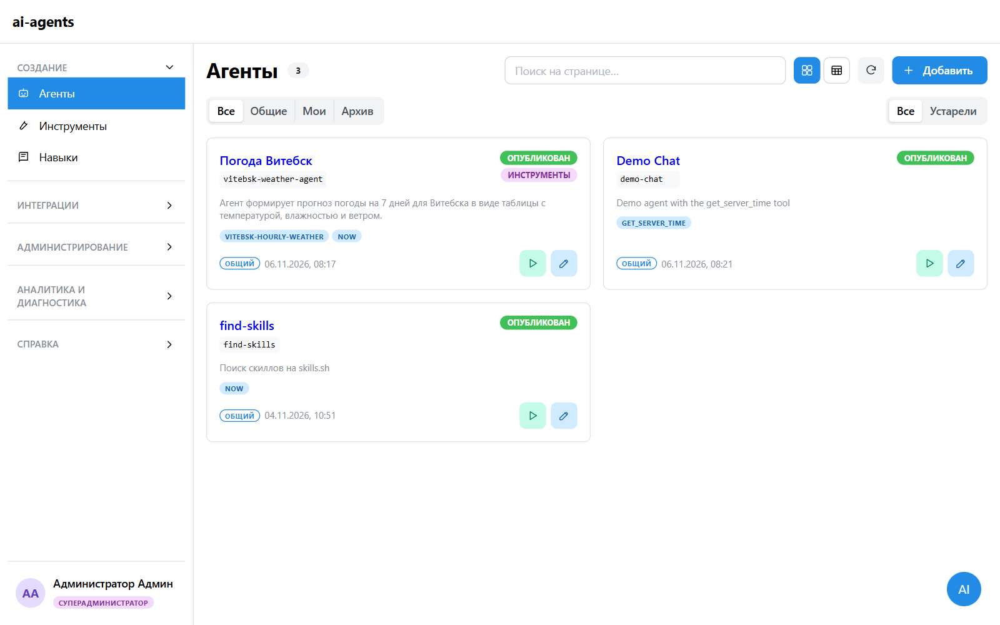
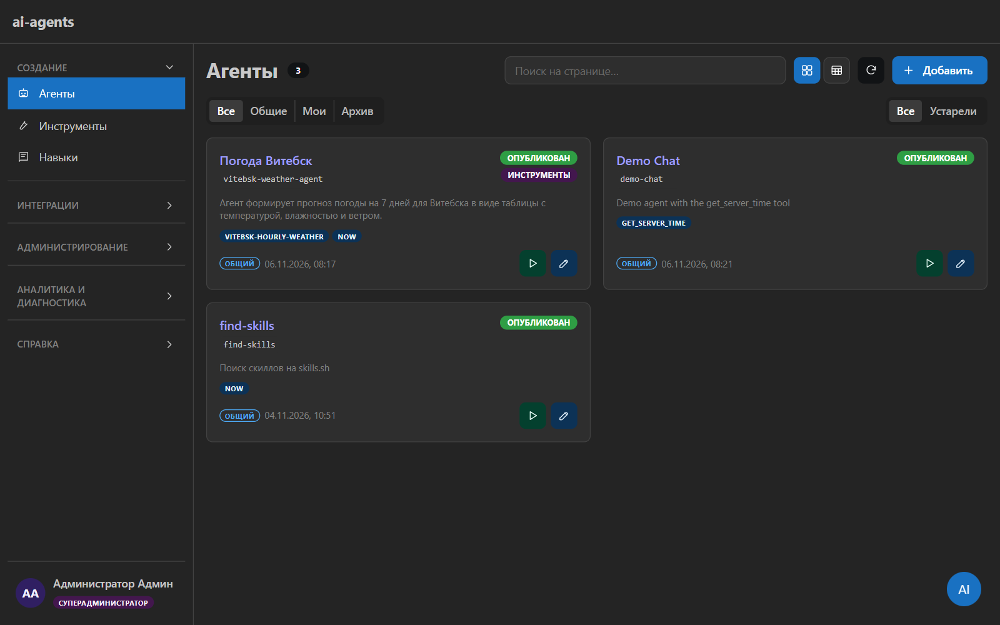
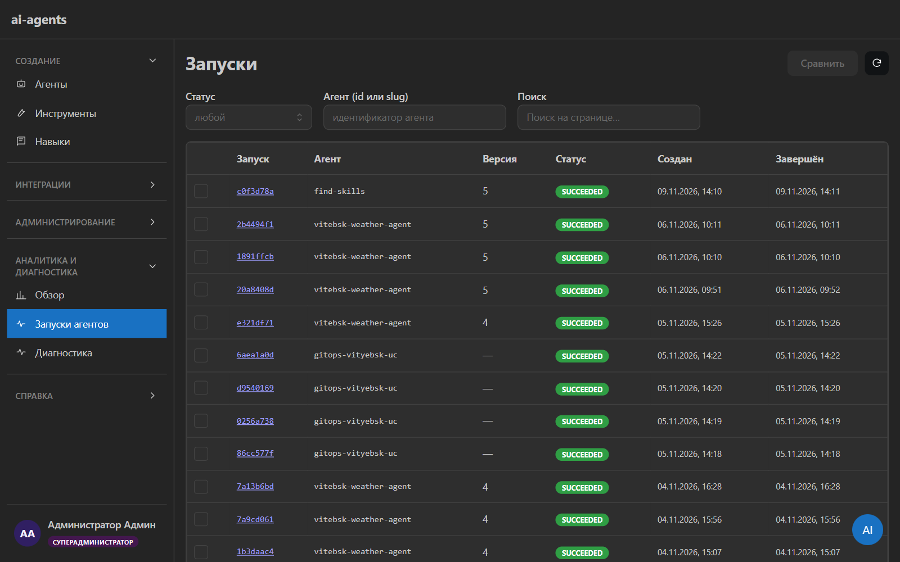
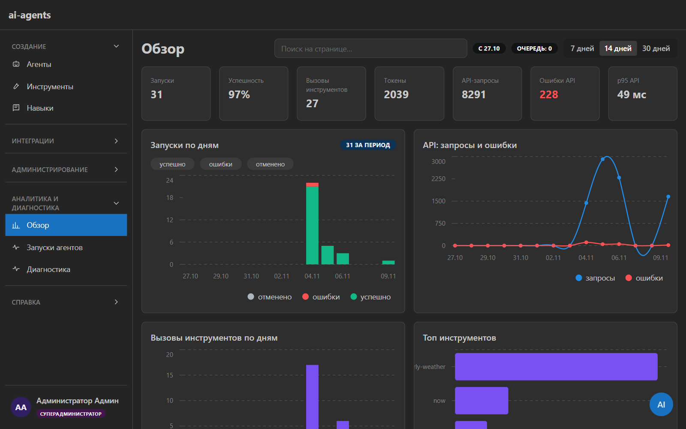
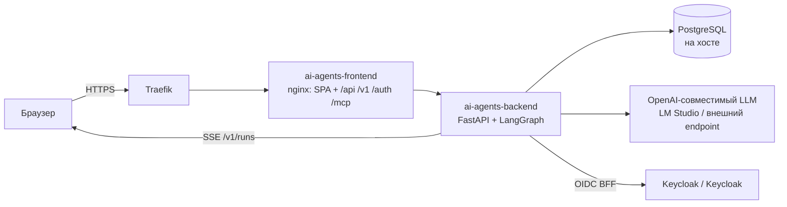

<div align="center">


<h1>ai-agents</h1>

Control plane агентов ai-agents: сборка, публикация и запуск LLM-агентов.<br>
LangGraph ReAct-агенты с инструментами, навыками и MCP, `POST /v1/runs` + SSE,
админка на React/Mantine, роли и лимиты, учёт использования.


<a href="https://github.com/DzmitrySha/ai-agents/tags"></a>


<sub>Русская версия · <a href="docs/API.md">API</a> · <a href="docs/NUANCES.md">NUANCES</a> · <a href="infra/k8s/ENV_LAYERS.md">ENV-слои</a> · <a href=".github/README.md">English</a></sub>

</div>

---

| Светлая тема | Тёмная тема |
|---|---|
|  |  |
|  |  |

> Скриншоты сняты с work-стенда (`ai-agents-dev.example.com`) под ролью
> superadmin: агенты, запуски, статистика. Переключатели темы и языка — в шапке/настройках.

## Содержание

- [Ключевые возможности](#ключевые-возможности)
- [Как это работает](#как-это-работает)
- [Быстрый старт](#быстрый-старт)
- [API](#api)
- [Доступ и роли](#доступ-и-роли)
- [Настройки](#настройки)
- [Деплой](#деплой)
- [Разработка и тесты](#разработка-и-тесты)
- [Структура проекта](#структура-проекта)
- [Документация](#документация)
- [Ограничения](#ограничения)
- [Участие](#участие)

## Ключевые возможности

| | |
|---|---|
| **Агенты как данные** | CRUD, версии, публикация, клонирование и откат на любую версию (публикуется новая). Системный промпт, LLM-профиль, лимиты шагов и времени. |
| **Инструменты** | Встроенные (`calculator`, `now`, `get_server_time`) и no-code HTTP-конструктор с тестированием. Правки инструмента применяются к запускам сразу. |
| **Навыки** | `SKILL.md`: импорт из skills.sh, свой навык по шаблону, генерация ассистентом по короткому промпту, редактирование в UI. |
| **MCP в обе стороны** | Серверы «наружу» (агенты как инструменты для внешних клиентов) и подключения «внутрь» (инструменты внешних MCP-серверов). |
| **Запуски и SSE** | `POST /v1/runs` + поток событий `GET /v1/runs/{id}/events`, отмена, preflight, approvals для изменяющих инструментов, digest/harness/transcript и сравнение запусков. |
| **Субагенты, память, расписания** | Вложенные запуски, память агента, cron-расписания, каналы уведомлений и delivery-outbox. |
| **LLM-провайдеры** | Именованные OpenAI-compatible провайдеры (base_url/ключ/модель), выбор активного, список моделей от провайдера. |
| **Доступ** | Люди — Keycloak OIDC (BFF cookie), машины — `SERVICE_API_KEYS` и DB-ключи со скоупами. Роли `superadmin`/`admin`/`user`, дневной лимит запусков. |
| **Каталог и invoke** | `/v1/catalog` + `/v1/tools/{ref}/invoke` для оркестраторов: агенты и инструменты как эксперты с allowlist для сервисных ключей. |
| **Аналитика** | Запуски, вызовы инструментов и API-запросы в Postgres (`usage_events`); графики «Использование», топ агентов/инструментов/эндпоинтов. Опционально Langfuse. |
| **Assist** | Чат по всему сервису и AI-автозаполнение форм (видит только зарегистрированную форму, не DOM). |
| **UI** | Stock Mantine, темы «Светлая» / «Тёмная» / «Portracker», единые каркасы разделов, i18n RU/EN (по умолчанию RU). |
| **Эксплуатация** | Структурные логи loguru с ротацией, `/health`, `/v1/doctor`, Compose + Traefik, offline-build, k8s GitOps + SOPS. |

## Как это работает



Traefik бьёт во frontend (nginx): SPA и reverse-proxy `/api`, `/v1`, `/auth`,
`/health`, `/mcp` → backend. Backend Persist-ит запуски и события в PostgreSQL
на хосте, а live-SSE и отмена выполняются в процессе (`RunManager` / `LiveHub`),
поэтому реплика одна. Инференс LLM — внешний OpenAI-совместимый endpoint;
app-поды GPU не запрашивают.

Деплой в prod — GitOps: `git tag` → CI `decide` → BuildKit/retag → `bump newTag`
→ Argo CD → k8s `ai-agents` с initContainer-миграцией.

## Быстрый старт

### Docker Compose (work-контур)

```bash
cp docker/.env.example docker/.env
cp docker/.env.secrets.example docker/.env.secrets
# docker/.env — FQDN, порты, OIDC auth-test; docker/.env.secrets — DATABASE_URL,
# KEYCLOAK_CLIENT_SECRET, SESSION_SECRET_KEY, SERVICE_API_KEYS
docker compose --env-file docker/.env --env-file docker/.env.secrets up -d --build
```

- `ai-agents-migrate` (`restart: "no"`) — единственный канал DDL: создаёт БД и накатывает
  миграции; backend ждёт его успешного завершения.
- Порты хоста: `${BACKEND_PUBLISH_PORT:-8096}` → backend:8080,
  `${FRONTEND_PUBLISH_PORT:-4196}` → frontend:80.
- Traefik: внешняя сеть `traefik_proxy`; `hosts`: `127.0.0.1 ai-agents-dev.example.com`.

Lab/home (локальный `keycloak-dev`, LM Studio на хосте):

```bash
cp docker/.env.lab.example docker/.env
docker compose -f docker-compose.yml -f docker-compose.lab.yml \
  --env-file docker/.env --env-file docker/.env.secrets up -d --build
```

Offline (сборка из локального кэша):

```powershell
.\scripts\docker\up-offline.ps1              # lab: build + up --lab
.\scripts\docker\up-offline.ps1 -NoBuild     # только up
.\scripts\docker\up-offline.ps1 -Work        # work-контур без lab-оверлея
```

### Локально без Docker

```bash
# backend
cd backend
uv sync --extra dev
cp ../docker/.env.example .env
cp ../docker/.env.secrets.example .env.secrets
SERVICE_API_KEYS=dev-key uv run alembic upgrade head
SERVICE_API_KEYS=dev-key uv run uvicorn app.main:app --reload --port 8096

# frontend (второй терминал): http://localhost:5173, proxy /api → :8096
cd frontend
npm ci
npm run dev
```

Проверка:

```bash
curl http://localhost:8096/health
curl http://localhost:8096/v1/agents -H "Authorization: Bearer dev-key"
```

Полный smoke (`POST /v1/runs` → SSE) — [`docs/API.md` § Smoke](docs/API.md#smoke-curl).

## API

Контракт — только [`docs/API.md`](docs/API.md). Опорные группы:

| Метод | Путь | Доступ |
|---|---|---|
| GET/POST | `/v1/agents`, `/v1/agents/{ref}` | `agents:read` / `agents:write` |
| POST | `/v1/agents/{ref}/publish` · `/rollback` · `/clone` | owner/superadmin |
| GET/POST | `/v1/tools`, `/v1/tools/custom` | `tools:*` или `agents:*` |
| POST | `/v1/tools/{ref}/test` · `/invoke` | `tools:write` / `tools:execute` |
| GET/POST | `/v1/skills`, `/v1/skills/import` | `skills:*` или `agents:*` |
| GET/POST | `/v1/mcp-connections` | `agents:read` / `agents:write` |
| POST | `/mcp` (Streamable HTTP) | Bearer `mcp-ag-…` |
| GET | `/v1/catalog`, `/v1/runs/{id}/harness`, `/digest`, `/transcript` | `runs:read` |
| POST | `/v1/runs`, `/v1/runs/preflight`, `/v1/runs/{id}/cancel` | `runs:execute` |
| GET | `/v1/runs/{id}/events?after=<seq>` | `runs:read` (SSE) |
| GET/POST | `/v1/schedules` | `runs:execute` |
| GET | `/v1/stats/overview?days=14` | `runs:read` |
| GET | `/v1/doctor` | `admin` |
| GET/PUT | `/v1/settings/llm` | `agents:read` / `admin` |
| GET/POST | `/api/admin/users`, `/api/admin/service-keys` | cookie superadmin |

`ref` — `id` (UUID) или `slug`. Полные правила доступа и коды ошибок —
[`docs/API.md`](docs/API.md).

## Доступ и роли

| Роль | Права |
|---|---|
| `superadmin` | всё: пользователи/роли/лимиты, сервисные и MCP-ключи, провайдеры LLM; bootstrap — `SUPERADMIN_EMAILS` |
| `admin` | CRUD и публикация своих агентов/навыков/инструментов, просмотр статистики; без управления доступами |
| `user` | опубликованные общие агенты: просмотр и тестовый запуск; дневной лимит (`USER_DAILY_RUN_LIMIT`) |

Люди входят через Keycloak (cookie-сессия), машины — Bearer-ключом
(`SERVICE_API_KEYS` или ключ из UI со скоупами и allowlist).

## Настройки

Полный список и слои Secret/ConfigMap — [`infra/k8s/ENV_LAYERS.md`](infra/k8s/ENV_LAYERS.md).

| Переменная | Назначение |
|---|---|
| `DATABASE_URL` | PostgreSQL на хосте (`postgresql+asyncpg://…@host.docker.internal:5432/ai_agents`) |
| `SERVICE_API_KEYS` | bootstrap-ключи `/v1/*` (полный доступ) |
| `KEYCLOAK_ISSUER/CLIENT_ID/CLIENT_SECRET/REDIRECT_URI` | OIDC BFF |
| `DIRECTORY_ADMIN_CLIENT_ID/SECRET` | необязательный клиент с `view-users` для каталога пользователей |
| `SUPERADMIN_EMAILS` | аккаунты, всегда получающие `superadmin` |
| `DEFAULT_LLM_BASE_URL/MODEL/API_KEY` | fallback LLM, если активный провайдер не задан |
| `MAX_STEPS`, `RUN_TIMEOUT_SECONDS` | дефолты агента; `*_CAP` — верхние границы |
| `USER_DAILY_RUN_LIMIT`, `USER_DAILY_TOKEN_LIMIT` | лимиты роли `user` (0 — без лимита) |
| `MCP_ALLOWED_HOSTS`, `MCP_EGRESS_ALLOWED_HOSTS` | DNS-rebinding allowlist и разрешённые приватные цели MCP |
| `GITHUB_TOKEN`, `SKILLS_SH_TOKEN` | импорт/поиск навыков |
| `LANGFUSE_HOST/PUBLIC_KEY/SECRET_KEY` | трассировка (опционально) |
| `STORAGE_PATH`, `LOG_DIR` | данные и логи (`/data`, `/data/logs`) |

Секреты (`DATABASE_URL`, `KEYCLOAK_CLIENT_SECRET`, `SESSION_SECRET_KEY`,
`SERVICE_API_KEYS`, ключи LLM/интеграций) — только `docker/.env.secrets` и SOPS-Secret,
никогда в ConfigMap и `.env.example`.

Логи: `app_YYYY-MM-DD.log`, ротация в 00:00, хранение 30 дней, старые файлы
сжимаются в `.zip`. В файл пишется `DEBUG`, в консоль — `INFO`.

## Деплой

### Контуры и FQDN

| Контур | FQDN | Стек |
|---|---|---|
| Lab/work | `ai-agents-dev.example.com` | Compose + Traefik, IdP `keycloak.example.com` |
| Prod k8s (prod) | `ai-agents.example.com` | Kustomize + Argo CD + SOPS, IdP `keycloak.example.com` |

### Prod (k8s + GitOps)

- Namespace: `ai-agents`; образы: `registry.example.com/ai-agents/backend`, `…/frontend`.
- Манифесты: [`infra/k8s`](infra/k8s) (ConfigMap, Deployments, Services, HTTPRoute, PVC).
- Миграции: `initContainer migrate-db` (`alembic upgrade head`).
- Секреты: `infra/k8s/ai-agents-secret.enc.yaml` (SOPS/KSOPS; создаёт ops, age-ключ не в CI).
- Данные: PVC `ai-agents-data` (RWO, `Recreate`, одна реплика) → `/data`.
- CI: `.gitlab-ci.yml`; **любой git tag** → `decide-images` → build/retag → `bump newTag` → Argo Sync.

```bash
git tag v0.1.0
git push origin v0.1.0
```

Выбор образов автоматический (diff к предыдущему тегу); override —
`BUILD_IMAGES=all|backend,frontend`. Offline-джобы живут в `gitlab-ci/offline/*`
и **не** подключены к root CI.

Деплой-заметки:
[`docs/NUANCES.md`](docs/NUANCES.md).

## Разработка и тесты

Зависимости — [uv](https://docs.astral.sh/uv/), зафиксированы в `backend/uv.lock`:

```bash
cd backend
uv sync --extra dev
uv run pytest -q            # 213 тестов, SQLite + мок LLM
uv run python -m compileall app
```

```bash
cd frontend
npm ci
npx tsc --noEmit
npm run build
```

Тесты изолированы от локальных `.env` (`SETTINGS_ENV_FILE=""`), поэтому не зависят
от стенда. CI на MR/main прогоняет те же проверки.

## Структура проекта

```text
backend/app/              FastAPI: settings, models, auth (OIDC BFF, scopes), repos/
backend/app/agents/       реестр инструментов, HTTP-инструменты, LangGraph, assist
backend/app/runtime/      RunManager, LiveHub, кэш LLM-настроек
backend/app/routers/      auth, agents, runs, tools, skills, mcp, settings, stats, admin
backend/alembic/          миграции (единственный канал DDL)
backend/tests/            pytest: auth, роли, runs, tools, skills, mcp, stats, settings
frontend/src/             SPA: страницы, компоненты, i18n (ru/en), темы
frontend/public/          favicon.svg, apple-touch-icon.png
docker/                   .env*.example, nginx template
docker-compose*.yml       work / lab / offline
scripts/docker/           up-offline.ps1, compose-offline.sh, validate кэша
gitlab-ci/offline/        offline-рецепты (не в root CI)
infra/k8s/                Kustomize, SOPS Secret, PVC, HTTPRoute, ENV_LAYERS
docs/                     API, гайды, NUANCES, FUTURE-IDEAS, screenshots
storage/                  данные Compose (в k8s — PVC)
```

## Документация

| Документ | Содержание |
|---|---|
| [`docs/API.md`](docs/API.md) | контракт API, доступ, SSE, инструменты/навыки, провайдеры, статистика |
| [`docs/GUIDE-EXTERNAL-API.md`](docs/GUIDE-EXTERNAL-API.md) | подключение внешних приложений: REST + общий MCP |
| [`docs/GUIDE-AGENTS-SKILLS-TOOLS.md`](docs/GUIDE-AGENTS-SKILLS-TOOLS.md) | создание агентов, навыков и инструментов (UI/API) |
| [`docs/NUANCES.md`](docs/NUANCES.md) | заметки по деплою и окружениям |
| [`infra/k8s/ENV_LAYERS.md`](infra/k8s/ENV_LAYERS.md) | слои env: Secret / ConfigMap / Settings |
| [`docs/FUTURE-IDEAS.md`](docs/FUTURE-IDEAS.md) | идеи на будущее (не контракт) |

## Ограничения

- Live-SSE и `RunManager` — in-process: **одна реплика** backend; горизонтальный
  scale без Redis fan-out не поддерживается.
- PostgreSQL — на хосте (не в Compose и не в кластере); DDL только Alembic.
- Инференс LLM — внешний endpoint; GPU в app-подах не запрашивается.
- «Плагин-пакеты (beta)»: страница `/admin/packs` и API работают, пункт меню скрыт.
- Оффлайн-сборка требует заполненный `offline-cache` (`offline cache`).

## Участие

Issues и pull requests —
[`DzmitrySha/ai-agents`](https://github.com/DzmitrySha/ai-agents).
Контракт API меняйте вместе с `docs/API.md` и тестами; секреты не коммитить.

Внутренний проект ai-agents (компания). Публичная копия для GitHub —
[`.github/README.md`](.github/README.md).
